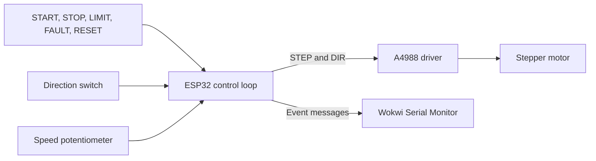
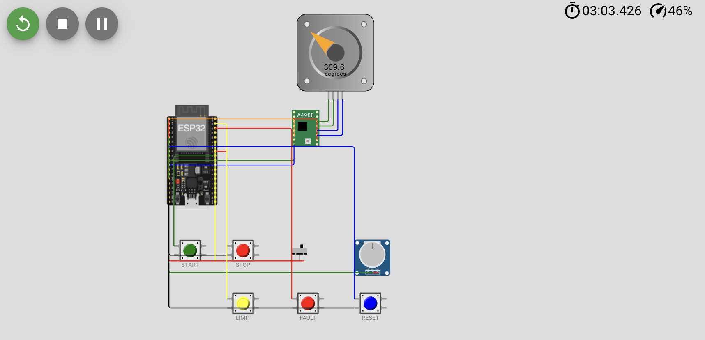

# Industrial Motor Controller

An embedded C++ simulation of an ESP32 controlling a stepper motor through an A4988 driver. The firmware combines operator commands, a travel-limit interlock, a latched fault, and serial event logging in a single polling loop. The complete circuit runs in Wokwi.

## Objectives

- Translate operator inputs into step and direction signals for a motor driver.
- Give stop and fault conditions priority over run commands.
- Require a deliberate reset and a fresh start command after a fault.
- Make state transitions observable through serial logs and the simulated motor angle display.

## Technologies and components

| Technology | Role |
| --- | --- |
| C++ and Arduino Framework | Firmware, GPIO, analog input, timing, and serial output |
| PlatformIO | Builds the `esp32dev` firmware using the Espressif 32 platform |
| Wokwi for VS Code | Simulates the circuit and displays serial output |

| Simulated component | Role |
| --- | --- |
| ESP32 DevKitC V4 | Reads controls and generates motor commands |
| A4988 stepper motor driver | Converts STEP and DIR signals into motor coil drive |
| Stepper motor | Displays motor movement and angle |
| Five push buttons | START, STOP, LIMIT, FAULT, and RESET. The LIMIT button represents a travel limit switch. |
| Slide switch | Selects forward or reverse |
| Potentiometer | Sets the commanded step rate |

## System architecture



### ESP32 GPIO assignments

| GPIO | Firmware signal | Function | Mode or level |
| --- | --- | --- | --- |
| 18 | `START_BUTTON` | Start command | Active-low input with internal pull-up |
| 19 | `STOP_BUTTON` | Manual stop | Active-low input with internal pull-up |
| 21 | `DIRECTION_SWITCH` | Direction selection | Digital input switched between GND and 3.3 V |
| 22 | `FAULT_BUTTON` | Simulated fault input | Active-low input with internal pull-up |
| 23 | `LIMIT_SWITCH` | Travel-limit interlock | Active-low input with internal pull-up |
| 26 | `STEP_PIN` | A4988 STEP | Digital output, pulsed high to advance the motor |
| 27 | `DIR_PIN` | A4988 DIR | Digital output that follows the direction switch |
| 32 | `RESET_BUTTON` | Manual fault reset | Active-low input with internal pull-up |
| 34 | `SPEED_POT` | Speed command | Analog input from the potentiometer wiper |

The diagram also connects the board's TX and RX pins to the Wokwi Serial Monitor. Both the firmware and PlatformIO configuration specify 115200 baud.

## Features and control logic

1. **Start from idle.** At boot, the motor state is stopped and STEP is low. A new START press is accepted when STOP, LIMIT, and FAULT are released, the fault latch is clear, and there is no RESET press edge in the same loop iteration.
2. **Choose direction and speed.** The firmware copies the direction input to DIR on every loop, so the next steps follow the selected direction even while running. The potentiometer reading is mapped from an ADC range of 0–4095 to a step interval of 20,000–2,000 µs. Higher readings shorten the interval. While running, the loop uses `micros()` to schedule steps and holds STEP high for 5 µs per pulse.
3. **Stop manually or at the travel limit.** STOP halts step pulses when the motor is running. LIMIT halts the motor and blocks START for as long as it is held. Releasing either input leaves the motor stopped until another START press. A limit event does not set the fault latch.
4. **Latch a simulated fault.** Pressing FAULT immediately clears the run state and drives STEP low when sampled by the loop. Releasing FAULT leaves the latch set, so START remains blocked.
5. **Reset and restart.** Release FAULT, then press RESET to clear the latch. A RESET press while FAULT is held is rejected. The motor stays stopped after a successful reset and requires a separate START press.

The loop handles fault detection, limit protection, and manual stop before evaluating reset and start. Each stop path inhibits motion commands by holding STEP low. START and RESET use falling-edge detection, so a held button does not repeatedly issue commands.

## Build and run

1. Open the project root in VS Code with the **PlatformIO IDE** and **Wokwi for VS Code** extensions installed. Activate a Wokwi license if prompted.
2. Open a PlatformIO terminal in the project root and build the firmware.

   ```sh
   pio run -e esp32dev
   ```

3. Confirm that the build succeeded. The included `wokwi.toml` points to `.pio/build/esp32dev/firmware.bin` and `.pio/build/esp32dev/firmware.elf`. The included `diagram.json` supplies the circuit and controls.
4. Open the VS Code Command Palette and run **Wokwi: Start Simulator**. Watch the simulator's Serial Monitor for `INDUSTRIAL MOTOR CONTROLLER` and `System ready`.
5. Click the simulated buttons or use their configured keyboard shortcuts while the simulator has focus. Use the slide switch and potentiometer to change direction and speed.

[Wokwi guide for PlatformIO projects](https://docs.wokwi.com/vscode/platformio) · [Wokwi for VS Code setup](https://docs.wokwi.com/vscode/getting-started)

## Manual testing in Wokwi

Run the steps in order from a fresh simulation. These are expected results from the firmware and circuit configuration.

| Check | Action | Expected result |
| --- | --- | --- |
| Startup | Start the simulator with the buttons released. | Motor stays still. Serial prints `INDUSTRIAL MOTOR CONTROLLER` and `System ready`. |
| Start | Press START (`S`). | Motor begins stepping and serial prints `MOTOR STARTED`. |
| Direction | Flip the slide switch while running. | The simulated motor angle advances in the opposite direction. |
| Speed | Sweep the potentiometer while running. | The simulated angle changes faster at higher potentiometer readings. |
| Manual stop | Press STOP (`X`), then release it. | Motor stops, serial prints `MOTOR STOPPED`, and motion stays stopped until START is pressed again. |
| Travel limit and restart interlock | Start the motor, hold LIMIT (`L`), and attempt START. Release START and LIMIT, then press START again. | Motor stops and serial prints `LIMIT SWITCH ACTIVATED`. START is blocked while LIMIT is held. Motion resumes only after the fresh START press. |
| Fault detection and reset rejection | While running, hold FAULT (`F`) and press RESET (`R`). | Motor stops. Serial prints `MOTOR FAULT DETECTED` and then `CANNOT RESET: FAULT ACTIVE`. |
| Fault latch | Release FAULT and RESET, then press START. | Motor remains stopped with no new `MOTOR STARTED` message. |
| Manual reset | Press RESET with FAULT released, then press START separately. | Serial prints `FAULT RESET SUCCESSFUL` and the motor remains stopped until START. A successful start prints `MOTOR STARTED`. |

## Project files

| File | Purpose |
| --- | --- |
| [src/main.cpp](src/main.cpp) | GPIO assignments, control logic, motor pulse timing, and serial events |
| [platformio.ini](platformio.ini) | ESP32 build environment and serial monitor speed |
| [diagram.json](diagram.json) | Simulated components, wiring, and keyboard shortcuts |
| [wokwi.toml](wokwi.toml) | Firmware and ELF paths used by Wokwi |

## Wokwi simulation screenshot



## Safety disclaimer

This project is an educational simulation. It has no industrial safety certification and must not be used to control real machinery or replace an emergency stop, safety interlock, or motor protection system. The FAULT button represents a simulated fault input, and the firmware's software stop acts by ceasing STEP pulses.

---

*powered by love from reeves your chilled guy*
